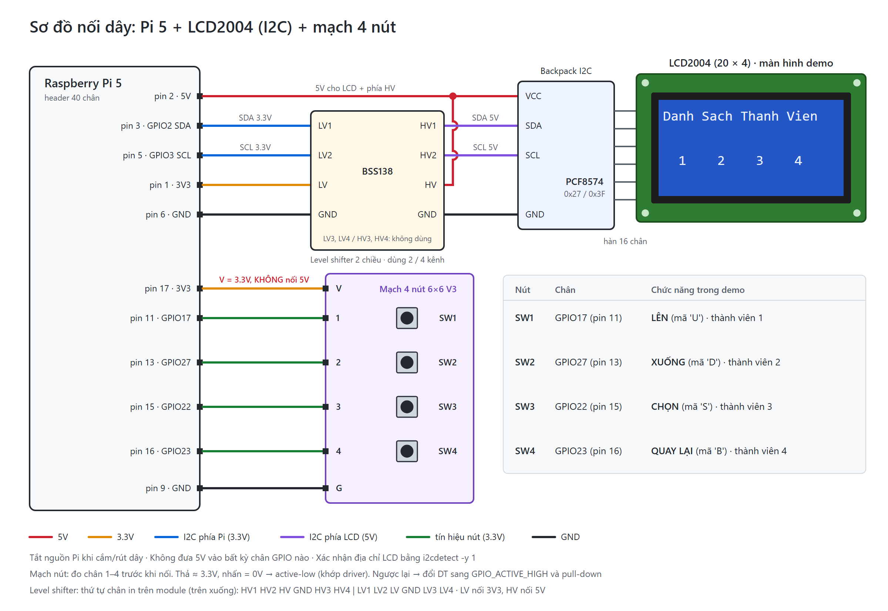

# Driver LCD2004 + 4 nút nhấn cho Raspberry Pi 5

Driver Linux (dạng module `.ko`) điều khiển màn hình **LCD2004** (chip HD44780, qua backpack I2C PCF8574) và **4 nút nhấn** (nút 1, 2, 3, 4) trên Raspberry Pi 5.

- Ghi chữ lên LCD: `echo "Hello" | sudo tee /dev/lcd2004`
- Điều khiển LCD (xóa, đặt con trỏ, đèn nền): `ioctl`
- Đọc nút nhấn: `read()` / `poll()` trên `/dev/lcd2004`

Mã nguồn chính:

| Đường dẫn | Nội dung |
|---|---|
| `driver/lcd2004_btn.c` | Driver (3 lớp: I2C, HD44780, giao diện Linux) |
| `include/lcd2004_ioctl.h` | Lệnh `ioctl` và mã nút, dùng chung cho driver và app |
| `dts/lcd2004-btn-overlay.dts` | Device Tree overlay cho Pi5 |
| `app/lcd_test.c`, `app/button_test.c` | Chương trình thử LCD và nút |
| `app/demo.c` | Chương trình demo: chữ chạy trên LCD, 4 nút chọn thành viên nhóm |
| `docs/HARDWARE.md` | Hướng dẫn phần cứng: linh kiện, nối dây, kiểm tra, lỗi thường gặp |
| `docs/QA.md` | Câu hỏi và trả lời để ôn vấn đáp |
| `docs/BUILTIN.md`, `tools/build-builtin.sh` | Mức "Tốt": build kernel có driver built-in (xem mục 10) |

Chương trình `demo` hiện chữ `Xin Chao` chạy trên LCD. Bấm nút bất kỳ thì ra danh sách thành viên. Mỗi nút (1 đến 4) chọn một thành viên: tên và MSSV chạy một lượt trên LCD rồi đứng yên.

---

## 1. Phần cứng

Hướng dẫn từng bước (danh sách linh kiện, thứ tự nối dây, kiểm tra trước khi cấp điện, mốc kiểm tra HW-1 đến HW-7) nằm ở [docs/HARDWARE.md](docs/HARDWARE.md). Bảng dưới là bảng nối dây tóm tắt.



| Từ | Đến | Ghi chú |
|---|---|---|
| Pi5 pin 2 (5V) | VCC của LCD backpack và chân HV của level shifter | LCD dùng khoảng 100 đến 150 mA |
| Pi5 pin 6 (GND) | GND của LCD và GND của level shifter | GND chung |
| Pi5 pin 1 (3V3) | Chân LV của level shifter | Chỉ làm điện áp tham chiếu |
| Pi5 pin 3 (GPIO2, SDA1) | LV1 của level shifter | |
| Pi5 pin 5 (GPIO3, SCL1) | LV2 của level shifter | |
| HV1 của level shifter | SDA của backpack | |
| HV2 của level shifter | SCL của backpack | |
| Pi5 pin 17 (3V3) | Chân V của mạch 4 nút | **3.3V, KHÔNG nối 5V** |
| Pi5 pin 11 (GPIO17) | Chân 1 của mạch nút (nút 1) | |
| Pi5 pin 13 (GPIO27) | Chân 2 của mạch nút (nút 2) | |
| Pi5 pin 15 (GPIO22) | Chân 3 của mạch nút (nút 3) | |
| Pi5 pin 16 (GPIO23) | Chân 4 của mạch nút (nút 4) | |
| Pi5 pin 9 (GND) | Chân G của mạch nút | Nhấn nút thì GPIO xuống mức thấp |

Trước khi nối mạch nút vào Pi, đo thử chân 1 đến 4 (cách đo ở `docs/HARDWARE.md` mục 4.1). Thả nút phải khoảng 3.3V, nhấn phải 0V. Overlay đang cấu hình đúng kiểu này (gọi là active-low). Nếu đo ra ngược lại (thả 0V, nhấn 3.3V) thì phải sửa overlay theo `docs/HARDWARE.md` mục 4.1.

> **CẢNH BÁO: KHÔNG nối SDA/SCL của backpack thẳng vào Pi5.**
> **Backpack chạy 5V và có điện trở pull-up lên 5V. GPIO của Pi5 chỉ chịu 3.3V và không có mạch bảo vệ. Phải đi qua level shifter.**
> **Tắt nguồn Pi5 khi cắm hoặc rút dây. Kiểm tra dây một lần nữa rồi mới cấp điện.**

Level shifter là module hai chiều BSS138 loại 4 kênh, nhưng chỉ dùng 2 kênh: kênh 1 cho SDA, kênh 2 cho SCL (kênh 3, 4 bỏ trống). Mỗi phía có 6 chân theo thứ tự in trên mạch: `HV1, HV2, HV, GND, HV3, HV4` và `LV1, LV2, LV, GND, LV3, LV4` (chi tiết ở `docs/HARDWARE.md` mục 3.1). Mạch nút chỉ cấp 3.3V. Tuyệt đối không cấp 5V vào bất kỳ chân GPIO nào.

---

## 2. Chuẩn bị Pi5

Quy ước cho mục 2 đến 6:

- Mọi lệnh đều chạy **trên Pi5** (terminal của Pi hoặc SSH), không chạy trên laptop.
- Repo được clone vào thư mục home, tức là `~/Pi5-Driver-Project`. Các lệnh bên dưới dùng đường dẫn đầy đủ này nên chạy ở đâu cũng được. Nếu clone ở chỗ khác thì sửa đường dẫn cho đúng.
- Sửa file bằng `nano`: dùng phím mũi tên để di chuyển. Lưu bằng **Ctrl+O** rồi **Enter**, thoát bằng **Ctrl+X**.

### Bước 2.1. Cài gói cần thiết

```bash
sudo apt update
sudo apt install -y git build-essential device-tree-compiler i2c-tools linux-headers-rpi-2712
```

Kết quả đúng: lệnh chạy xong không báo lỗi. Kiểm tra thêm bằng lệnh dưới, phải hiện ra danh sách thư mục (không báo `No such file or directory`):

```bash
ls /lib/modules/$(uname -r)/build
```

### Bước 2.2. Bật I2C

1. Mở file cấu hình:

   ```bash
   sudo nano /boot/firmware/config.txt
   ```

2. Tìm dòng `dtparam=i2c_arm=on`:
   - Đã có sẵn, không có dấu `#` ở đầu: giữ nguyên, không cần làm gì.
   - Có dạng `#dtparam=i2c_arm=on`: xóa dấu `#` ở đầu dòng.
   - Không có: thêm dòng `dtparam=i2c_arm=on` vào **cuối file**.
3. Lưu file (Ctrl+O, Enter), thoát (Ctrl+X), rồi khởi động lại:

   ```bash
   sudo reboot
   ```

### Bước 2.3. Tìm địa chỉ LCD

```bash
sudo i2cdetect -y 1
```

Lệnh in ra một bảng số. Mỗi ô có thiết bị trả lời sẽ hiện địa chỉ của thiết bị đó, ô trống hiện `--`. Kết quả đúng: trong bảng có số `27` (ở hàng `20:`) hoặc `3f` (ở hàng `30:`). **Ghi lại số này**, bước 3.3 cần dùng. Không thấy số nào thì xem mục 9.

### Bước 2.4. Lấy mã nguồn

```bash
cd ~
git clone https://github.com/AnNguen-TwT-Projects/Pi5-Driver-Project.git
```

Lệnh `clone` tự lấy nhánh `main`, là nhánh chứa code chính.

Kết quả đúng: lệnh `ls ~/Pi5-Driver-Project` thấy các thư mục `driver`, `dts`, `app`, `include`.

Nếu đã clone từ trước thì không clone lại, chỉ cần chuyển về `main` và cập nhật (bản clone cũ có thể đang ở nhánh `feature/lcd2004-driver`):

```bash
cd ~/Pi5-Driver-Project
git checkout main
git pull
```

---

## 3. Build và cài Device Tree overlay

Overlay là file mô tả phần cứng: "trên bus I2C1, ở địa chỉ `0x27`, có một LCD, và có 4 nút ở GPIO 17, 27, 22, 23". Khi Pi khởi động, firmware đọc overlay để kernel biết có thiết bị này. Nhờ đó, khi nạp driver ở mục 4 thì driver mới tìm thấy LCD. Mục này gồm 4 bước: biên dịch, chép vào `/boot`, bật trong `config.txt`, kiểm tra.

### Bước 3.1. Biên dịch overlay

```bash
cd ~/Pi5-Driver-Project/dts
dtc -@ -I dts -O dtb -o lcd2004-btn.dtbo lcd2004-btn-overlay.dts
```

Lệnh này đọc file nguồn `lcd2004-btn-overlay.dts` (dạng chữ) và tạo ra file `lcd2004-btn.dtbo` (dạng nhị phân, là file firmware đọc được).

Kết quả đúng: lệnh `ls ~/Pi5-Driver-Project/dts` thấy file `lcd2004-btn.dtbo`.

### Bước 3.2. Chép overlay vào thư mục của firmware

```bash
sudo cp ~/Pi5-Driver-Project/dts/lcd2004-btn.dtbo /boot/firmware/overlays/
```

Kết quả đúng: lệnh `ls /boot/firmware/overlays/lcd2004-btn.dtbo` in ra đúng tên file đó, không báo lỗi.

### Bước 3.3. Bật overlay trong `config.txt`

Chép file vào `/boot` thì chưa đủ: firmware chỉ nạp overlay khi `config.txt` có dòng `dtoverlay=` gọi tên nó. Tên ở đây là tên file `.dtbo` bỏ phần đuôi, tức là `lcd2004-btn`.

1. Mở file cấu hình (cùng file với bước 2.2):

   ```bash
   sudo nano /boot/firmware/config.txt
   ```

2. Kéo xuống **cuối file**. Thêm **đúng một** dòng, chọn theo địa chỉ đã ghi lại ở bước 2.3:

   | Bước 2.3 thấy số | Thêm dòng này |
   |---|---|
   | `27` | `dtoverlay=lcd2004-btn` |
   | `3f` | `dtoverlay=lcd2004-btn,addr=0x3f` |

   Không thêm cả hai dòng. Phần `,addr=0x3f` là tham số đổi địa chỉ LCD trong overlay, mặc định là `0x27`.

   Cuối file sau khi thêm sẽ giống thế này (trường hợp thấy `27`):

   ```
   [all]
   dtoverlay=lcd2004-btn
   ```

   Nếu file có các dòng tiêu đề trong ngoặc vuông như `[cm4]`, `[cm5]`, `[all]` thì dòng mới phải nằm **sau dòng `[all]` cuối cùng**. Dòng đặt dưới `[cm4]` hoặc `[cm5]` chỉ áp dụng cho các board đó, Pi5 sẽ bỏ qua. Cách đơn giản nhất là thêm vào dòng cuối cùng của file.

3. Giữ nguyên dòng `dtparam=i2c_arm=on` của bước 2.2.
4. Lưu file (Ctrl+O, Enter), thoát (Ctrl+X), rồi khởi động lại:

   ```bash
   sudo reboot
   ```

### Bước 3.4. Kiểm tra overlay đã được nạp

Nếu bước 2.3 thấy `27`:

```bash
cat /sys/bus/i2c/devices/1-0027/name
```

Nếu bước 2.3 thấy `3f`:

```bash
cat /sys/bus/i2c/devices/1-003f/name
```

Kết quả đúng: in ra `lcd2004-btn`. Báo `No such file or directory` nghĩa là overlay chưa được nạp, xem mục 9.

Lúc này **chưa có** `/dev/lcd2004` và LCD chưa hiện gì là đúng, vì driver chưa nạp (mục 4).

---

## 4. Build và nạp driver

### Bước 4.1. Build

```bash
cd ~/Pi5-Driver-Project/driver
make
```

Kết quả đúng: trong thư mục `driver` có file `lcd2004_btn.ko`, và lúc build không có dòng nào chứa chữ `warning`.

### Bước 4.2. Nạp driver

```bash
sudo insmod ~/Pi5-Driver-Project/driver/lcd2004_btn.ko
```

Kết quả đúng:
- LCD sáng và hiện màn hình chào gồm 3 dòng: `LCD2004 driver OK` (hàng 0), `Raspberry Pi 5` (hàng 1), `Chay ./demo` (hàng 3).
- Lệnh `sudo dmesg | tail` có dòng chứa `probe ok`.
- Lệnh `ls -l /dev/lcd2004` in ra file thiết bị, không báo lỗi.

`insmod` chỉ nạp driver vào RAM. **Mỗi lần khởi động lại Pi5 phải chạy lại lệnh `insmod` này.** Các bước khác (I2C, overlay, các file đã build) không cần làm lại.

### Bước 4.3. Dùng thử bằng lệnh echo

```bash
echo "Hello" | sudo tee /dev/lcd2004
```

Kết quả đúng: hàng 0 của LCD bắt đầu bằng `Hello`, không có ký tự rác. Chữ cũ của màn hình chào còn sót lại phía sau `Hello` là bình thường, vì lệnh này chỉ ghi đè từ vị trí con trỏ, không xóa màn hình.

Phải dùng `| sudo tee`, không dùng `sudo echo "Hello" > /dev/lcd2004`. Ở cách sau, dấu `>` do shell của người dùng thường thực hiện chứ không phải `sudo`, nên sẽ báo `Permission denied`.

---

## 5. Build và chạy chương trình thử

Các lệnh từ bước 5.2 đến 5.4 chạy trong thư mục `~/Pi5-Driver-Project/app`. Driver phải đang được nạp (bước 4.2).

### Bước 5.1. Build

```bash
cd ~/Pi5-Driver-Project/app
make
```

Kết quả đúng: trong thư mục `app` có ba file `lcd_test`, `button_test` và `demo`.

### Bước 5.2. Chạy `lcd_test`

```bash
sudo ./lcd_test
```

Kết quả đúng: trong terminal mỗi mục in `PASS`, cuối cùng in `ALL PASS`. Trong lúc chạy, LCD hiện 4 hàng `Hang 0` đến `Hang 3`, sau đó chữ `X` ở hàng 1 cột 5, rồi đèn nền tắt 1 giây và sáng lại. Mục cuối xóa màn hình nên chạy xong LCD trống là đúng.

### Bước 5.3. Chạy `button_test`

```bash
sudo ./button_test
```

Nhấn lần lượt từng nút. Kết quả đúng: mỗi lần nhấn in đúng một dòng, ví dụ `[14:03:21.457] NUT 1`. Bốn tên là `NUT 1`, `NUT 2`, `NUT 3`, `NUT 4`. Giữ nút lâu cũng chỉ in một dòng. Nhấn Ctrl+C để thoát.

### Bước 5.4. Chạy demo

```bash
sudo ./demo
```

Nút 1 đến 4 ứng với thành viên 1 đến 4. Kết quả đúng:
1. LCD hiện chữ `Xin Chao` chạy liên tục từ trái sang phải ở hàng 1. Bấm nút bất kỳ thì ra màn danh sách (hàng 0 `Danh Sach Thanh Vien`, hàng 2 các số `1`, `2`, `3`, `4`).
2. Bấm từng nút 1 đến 4: họ tên và MSSV của người đó chạy một lượt, rồi đứng yên (tên ở trên, MSSV ở dưới). Để yên 10 giây thì quay về danh sách.
3. Đang chạy chữ mà bấm số khác thì chuyển ngay sang người đó.
4. Nhấn Ctrl+C: LCD hiện `Demo da thoat`.

> **Lưu ý:** tên và MSSV trong demo hiện là tên mẫu (`Ho Ten 1`, `00000001`, ...). Muốn đổi, sửa bảng `members[]` ở đầu file `app/demo.c` (viết không dấu, vì LCD không hiện được chữ có dấu), rồi chạy lại `make` trong thư mục `app`.

---

## 6. Gỡ và xóa driver

Có hai mức: gỡ tạm driver khỏi kernel (bước 6.1), hoặc xóa hết mọi thứ đã cài để làm lại từ đầu (bước 6.2 và 6.3).

### Bước 6.1. Gỡ driver khỏi kernel

```bash
sudo rmmod lcd2004_btn
```

Kết quả đúng: lệnh chạy xong không báo lỗi, đèn nền tắt, và lệnh `ls /dev/lcd2004` báo `No such file or directory`.

Nếu báo `Module lcd2004_btn is in use` thì đóng chương trình đang mở `/dev/lcd2004` (ví dụ `button_test`) rồi gỡ lại.

Nạp lại driver bằng lệnh của bước 4.2:

```bash
sudo insmod ~/Pi5-Driver-Project/driver/lcd2004_btn.ko
```

### Bước 6.2. Xóa hết để làm lại từ đầu

Làm trên Pi5, theo thứ tự ngược với lúc cài.

1. Thoát chương trình đang mở `/dev/lcd2004` (`demo`, `button_test`, ...) bằng Ctrl+C, rồi gỡ driver như bước 6.1. Nếu báo `not currently loaded` thì driver chưa nạp, bỏ qua.

2. Nếu trước đó đã chép `lcd2004_btn.ko` vào `/lib/modules` để driver tự nạp khi boot thì xóa file đó (chưa làm thì bỏ qua):

   ```bash
   sudo rm /lib/modules/$(uname -r)/extra/lcd2004_btn.ko
   sudo depmod -a
   ```

3. Gỡ overlay. Sao lưu `config.txt` trước, rồi mở file:

   ```bash
   sudo cp /boot/firmware/config.txt /boot/firmware/config.txt.bak
   sudo nano /boot/firmware/config.txt
   ```

   Chỉ xóa dòng `dtoverlay=lcd2004-btn` (hoặc `dtoverlay=lcd2004-btn,addr=0x3f`), giữ nguyên các dòng khác. Nên giữ `dtparam=i2c_arm=on` để còn dùng `i2cdetect` kiểm tra phần cứng. Lưu file, rồi xóa file overlay:

   ```bash
   sudo rm /boot/firmware/overlays/lcd2004-btn.dtbo
   ```

4. Xóa mã nguồn trên Pi5 (bản trên GitHub và trên laptop không bị ảnh hưởng). Kiểm tra trước xem có sửa gì trên Pi mà chưa push không:

   ```bash
   cd ~/Pi5-Driver-Project
   git status
   ```

   Nếu có file `modified` (ví dụ `app/demo.c` đã điền tên thật) thì chép file đó ra chỗ khác trước. Sau đó xóa thư mục repo (sửa đường dẫn nếu đã clone ở chỗ khác):

   ```bash
   cd ~
   rm -rf ~/Pi5-Driver-Project
   ```

   Nếu muốn giữ repo, chỉ xóa các file đã build thì thay lệnh `rm -rf` ở trên bằng:

   ```bash
   cd ~/Pi5-Driver-Project
   make -C driver clean
   make -C app clean
   rm -f dts/lcd2004-btn.dtbo
   ```

5. Khởi động lại:

   ```bash
   sudo reboot
   ```

### Bước 6.3. Kiểm tra đã xóa sạch

| Lệnh | Kết quả đúng |
|---|---|
| `lsmod \| grep lcd2004` | Không in gì |
| `ls /dev/lcd2004` | Báo `No such file or directory` |
| `ls /sys/bus/i2c/devices/` | Không còn `1-0027` (hoặc `1-003f`) |
| `ls /boot/firmware/overlays/ \| grep lcd2004` | Không in gì |
| `sudo i2cdetect -y 1` | Vẫn thấy `27` (hoặc `3f`), vì phần cứng vẫn nối và I2C vẫn bật |

LCD lúc này trống hoặc còn chữ cũ đều bình thường (LCD có thể không mất điện khi Pi5 khởi động lại).

Làm lại từ đầu: các gói ở bước 2.1 và I2C ở bước 2.2 vẫn còn, nên bắt đầu từ bước 2.3, rồi làm tiếp mục 3, 4, 5.

---

## 7. Giao diện cho chương trình (`include/lcd2004_ioctl.h`)

Mở thiết bị bằng `open("/dev/lcd2004", ...)`. Cần quyền root hoặc đổi quyền file.

**`write(fd, buf, n)`**: in chữ tại vị trí con trỏ.
- `\n` xuống đầu hàng kế tiếp. Hàng đã đủ 20 ký tự thì ký tự tiếp theo tự sang đầu hàng kế (nên 20 ký tự rồi `\n` chỉ xuống đúng 1 hàng). Hàng 3 xuống thì quay về hàng 0.
- Chỉ nhận ký tự ASCII từ 0x20 đến 0x7E. Ký tự khác bị bỏ qua (chữ có dấu không hiện được).

**`ioctl(fd, lệnh, ...)`**:

| Lệnh | Tham số | Tác dụng |
|---|---|---|
| `LCD_IOC_CLEAR` | không có | Xóa màn hình, con trỏ về hàng 0, cột 0 |
| `LCD_IOC_SET_CURSOR` | con trỏ tới `struct lcd_pos { __u8 row; __u8 col; }` | Đặt con trỏ. `row` từ 0 đến 3, `col` từ 0 đến 19. Sai thì trả `-1`, `errno = EINVAL` |
| `LCD_IOC_BACKLIGHT` | **con trỏ tới `int`**: 0 tắt, khác 0 bật | Bật hoặc tắt đèn nền |

Lệnh không biết thì trả `-1`, `errno = ENOTTY`. Ví dụ tắt đèn nền:

```c
int v = 0;
ioctl(fd, LCD_IOC_BACKLIGHT, &v);   // truyền ĐỊA CHỈ của v, không truyền giá trị
```

**`read(fd, buf, n)`**: mỗi byte đọc được là một sự kiện nhấn nút (mỗi lần nhấn đúng một byte). Mặc định `read` chờ đến khi có nút nhấn. Mở với `O_NONBLOCK` thì chưa có sự kiện sẽ trả `-1`, `errno = EAGAIN`.

| Mã | Nút | GPIO |
|---|---|---|
| `'1'` (`LCD_BTN_1`) | Nút 1 | 17 |
| `'2'` (`LCD_BTN_2`) | Nút 2 | 27 |
| `'3'` (`LCD_BTN_3`) | Nút 3 | 22 |
| `'4'` (`LCD_BTN_4`) | Nút 4 | 23 |

**`poll()` / `select()`**: báo `POLLIN` khi có sự kiện nút chưa đọc.

---

## 8. Biên dịch thử trên laptop (WSL)

Dùng để kiểm tra lỗi biên dịch trước khi mang lên Pi5. Mục này chạy **trên laptop**, trong Ubuntu WSL, bắt đầu từ thư mục gốc của repo (thư mục chứa file `README.md` này):

```bash
bash tools/setup-wsl.sh --kernel
cd driver
make KDIR=$HOME/rpi-linux ARCH=arm64 CROSS_COMPILE=aarch64-linux-gnu- KBUILD_MODPOST_WARN=1
```

(`KDIR` là thư mục mã nguồn kernel mà script đã tải, mặc định `~/rpi-linux`. Nếu bạn để kernel ở chỗ khác thì đổi `KDIR` cho đúng.)

Kết quả đúng: tạo ra `lcd2004_btn.ko`, không có `warning` từ trình biên dịch. Các cảnh báo `modpost` về `Module.symvers` và `undefined` là bình thường.

> **Lưu ý:** file `.ko` build kiểu này **KHÔNG nạp lên Pi được** (thiếu `Module.symvers`). Nó chỉ để kiểm tra lỗi biên dịch. Muốn có `.ko` để `insmod`, hãy build lại trên Pi5 theo mục 4.

Chương trình trong `app/` có thể biên dịch chéo bằng `make CC=aarch64-linux-gnu-gcc`.

---

## 9. Xử lý sự cố

| Hiện tượng | Cách xử lý |
|---|---|
| LCD sáng nhưng không thấy chữ (chỉ có ô vuông hoặc trống) | Dùng tua vít chỉnh biến trở độ tương phản ở mặt sau backpack |
| `i2cdetect -y 1` không thấy `27` hay `3f` | Tắt nguồn, kiểm tra dây SDA/SCL, GND, 5V và dây của level shifter. Kiểm tra đã bật `dtparam=i2c_arm=on` (bước 2.2) và đã khởi động lại |
| `i2cdetect` báo `Could not open file /dev/i2c-1` | Bật I2C bằng `sudo raspi-config`, chọn Interface Options, rồi I2C, rồi Yes, sau đó khởi động lại. Công cụ này bật cả module `i2c-dev` mà `i2cdetect` cần |
| `insmod` chạy xong nhưng không có `/dev/lcd2004`, hoặc `insmod` báo lỗi | Xem `sudo dmesg \| tail`. Thường do chưa bật overlay (kiểm tra lại bước 3.4) hoặc sai địa chỉ (`addr=0x3f`) |
| `insmod` báo `Invalid module format` | Kernel đã đổi phiên bản (thường sau `apt upgrade`). Build lại driver theo bước 4.1 |
| Bước 3.4 báo `No such file or directory` | Overlay chưa được nạp. Kiểm tra: file `/boot/firmware/overlays/lcd2004-btn.dtbo` có tồn tại; dòng `dtoverlay=` trong `config.txt` viết đúng tên `lcd2004-btn` và nằm sau dòng `[all]` cuối cùng (bước 3.3); đã khởi động lại. Xem thêm `sudo dmesg \| grep -i overlay` (lỗi label như `i2c_arm`, `gpio` chỉ hiện lúc nạp, `dtc` không báo) |
| `echo ... > /dev/lcd2004` báo `Permission denied` | Dùng `echo "Hello" \| sudo tee /dev/lcd2004` (xem bước 4.3) |
| `rmmod` báo `in use` | Đóng chương trình đang mở `/dev/lcd2004` (`button_test`, `lcd_test`, ...), rồi `rmmod` lại |
| Một nút ra tên của nút khác | Kiểm tra thứ tự dây theo bảng mục 1 (thứ tự trong `button-gpios` là nút 1, 2, 3, 4) |
| `make` báo không tìm thấy thư mục build | Cài `linux-headers-rpi-2712` và kiểm tra `uname -r` khớp với `/lib/modules` |

---

## 10. (Mức Tốt) Driver built-in

Các mục trên dùng driver dạng module `.ko` (mức "Đáp ứng"). Muốn biên dịch driver chung với kernel, để boot xong driver chạy sẵn mà không cần `insmod` (mức "Tốt"), làm theo [docs/BUILTIN.md](docs/BUILTIN.md). Chỉ làm sau khi bản `.ko` đã chạy đúng HW-1 đến HW-7. Kernel gốc được giữ nguyên nên luôn quay lại được.
