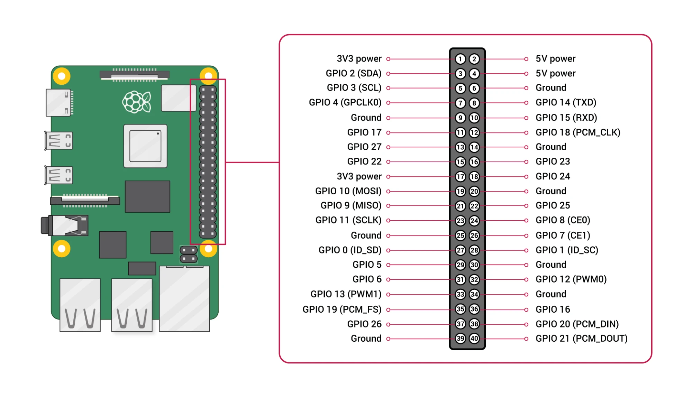

# Hướng dẫn phần cứng

Tài liệu này hướng dẫn từng bước từ lúc chuẩn bị linh kiện đến lúc kiểm tra xong phần cứng. Bảng nối dây gốc nằm ở `README.md` mục 1 và sơ đồ ở `docs/wiring-lcd2004-4-buttons.png`. Đọc hết một lượt trước khi cắm dây.

Quy tắc an toàn (áp dụng cho mọi bước):

1. **Tắt nguồn Pi5 khi cắm hoặc rút dây.** Rút dây nguồn USB-C ra, không chỉ tắt bằng lệnh.
2. **Chân GPIO của Pi5 chỉ chịu 3.3V.** Một dây 5V chạm nhầm vào GPIO có thể làm hỏng Pi5.
3. Cắm xong thì đối chiếu lại với bảng ở mục 3 một lần nữa, rồi mới cấp điện.

---

## 1. Danh sách linh kiện

| Linh kiện | Số lượng | Ghi chú |
|---|---|---|
| Raspberry Pi 5 và nguồn USB-C 5V/5A | 1 | Dùng nguồn chính hãng để khỏi bị sụt áp |
| LCD2004 có backpack I2C (chip PCF8574) | 1 | Địa chỉ I2C là `0x27` hoặc `0x3F` |
| Mạch 4 nút nhấn (chân V, 1, 2, 3, 4, G) | 1 | Theo sơ đồ nhóm đã vẽ |
| Module level shifter hai chiều 4 kênh (mặt không có linh kiện in chữ "Level Converter", loại BSS138) | 1 | 12 chân, mỗi phía 6 chân. Dùng 2 kênh cho SDA và SCL, 2 kênh còn lại để trống |
| Breadboard | 1 | |
| Dây Dupont đực-đực, đực-cái, cái-cái | khoảng 20 | Dây I2C nên ngắn, dưới 20 cm |
| Đồng hồ vạn năng | 1 | Để đo mạch nút và kiểm tra ngắn mạch |

---

## 2. Sơ đồ chân Pi5 dùng trong project

Header 40 chân của Pi5. Số trong bảng là **số chân vật lý** (đếm theo thứ tự trên header), không phải số GPIO.

| Chân vật lý | Tên | Dùng cho |
|---|---|---|
| 1 | 3V3 | LV của level shifter |
| 2 | 5V | VCC của LCD và HV của level shifter |
| 3 | GPIO2 (SDA1) | I2C dữ liệu, qua level shifter |
| 5 | GPIO3 (SCL1) | I2C xung nhịp, qua level shifter |
| 6 | GND | GND của LCD và level shifter |
| 9 | GND | GND của mạch nút |
| 11 | GPIO17 | Nút 1 |
| 13 | GPIO27 | Nút 2 |
| 15 | GPIO22 | Nút 3 |
| 16 | GPIO23 | Nút 4 |
| 17 | 3V3 | Chân V của mạch nút |

*Nguồn: tài liệu chính thức của Raspberry Pi, https://www.raspberrypi.com/documentation/computers/raspberry-pi.html. Ảnh gốc là của Raspberry Pi Ltd.*

Cách tìm đúng chân (theo ảnh trên): đặt board sao cho các cổng USB và Ethernet nằm phía dưới, header ở mép phải. Cột sát mép board là hàng chẵn (2, 4, 6, ...), cột phía trong là hàng lẻ (1, 3, 5, ...). Chân 1 và chân 2 nằm ở đầu header xa cổng USB và Ethernet. Trước khi cắm, đối chiếu chân 1 (3V3), chân 2 (5V) và chân 6 (GND) với ảnh. Cũng có thể chạy lệnh `pinout` trên Pi5 để in sơ đồ header ra terminal.

Bảng ở trên đã được đối chiếu với ảnh này: chân 1 và 17 là 3V3, chân 2 là 5V, chân 3 là GPIO2 (SDA), chân 5 là GPIO3 (SCL), chân 6 và 9 là GND, chân 11, 13, 15, 16 là GPIO17, 27, 22, 23.

---

## 3. Các bước nối dây

Làm theo thứ tự, nối xong bước nào thì tích bước đó. Tất cả khi Pi5 đã **rút nguồn**.

### Bước 3.1. Đặt level shifter lên breadboard

Module của nhóm có hai hàng chân, mỗi hàng 6 chân. Đặt module mặt không có linh kiện hướng lên, chữ "Level Converter" in ở giữa mạch đọc được theo chiều dọc. Thứ tự chân in trên mạch, từ trên xuống dưới (thứ tự này khác thứ tự thường gặp trên nhiều tài liệu, nên đối chiếu với chữ in trên module thật trước khi cắm):

| Hàng HV (phía LCD, 5V) | Hàng LV (phía Pi5, 3.3V) |
|---|---|
| `HV1` | `LV1` |
| `HV2` | `LV2` |
| `HV` | `LV` |
| `GND` | `GND` |
| `HV3` | `LV3` |
| `HV4` | `LV4` |

- Chân `HV` và `LV` là chân cấp điện áp tham chiếu của mỗi phía, không phải chân tín hiệu.
- Hai chân `GND` của hai hàng thông với nhau, chỉ cần nối một chân GND, nhưng nối cả hai cũng không sao.
- Dùng `LV1` và `HV1` cho SDA, `LV2` và `HV2` cho SCL. Hai kênh `LV3`/`HV3` và `LV4`/`HV4` để trống.
- Trên mạch có 8 điện trở dán ghi `103` (nghĩa là 10 kΩ), tức mỗi kênh đã có sẵn điện trở kéo lên ở cả hai phía. Backpack LCD và Pi5 cũng có điện trở kéo riêng, các điện trở này song song với nhau nên không ảnh hưởng đến chạy.
- Nếu module bán kèm hàng chân rời thì phải hàn chân vào trước, rồi mới cắm lên breadboard.

### Bước 3.2. Nối nguồn và GND

| Từ | Đến |
|---|---|
| Pi5 chân 1 (3V3) | `LV` của level shifter |
| Pi5 chân 2 (5V) | `HV` của level shifter, và `VCC` của LCD |
| Pi5 chân 6 (GND) | `GND` của level shifter, và `GND` của LCD |

Chân 2 phải chia ra hai dây. Dùng đường ray nguồn (+) của breadboard: nối chân 2 vào ray, từ ray đưa ra `HV` và `VCC`. Làm tương tự cho GND.

### Bước 3.3. Nối I2C qua level shifter

| Từ | Đến |
|---|---|
| Pi5 chân 3 (SDA) | `LV1` (hàng LV, chân trên cùng) |
| `HV1` (hàng HV, chân trên cùng) | `SDA` của backpack LCD |
| Pi5 chân 5 (SCL) | `LV2` (hàng LV, chân thứ hai) |
| `HV2` (hàng HV, chân thứ hai) | `SCL` của backpack LCD |

Vì sao cần level shifter: backpack chạy 5V và có điện trở kéo lên 5V trên SDA/SCL, nên nếu nối thẳng thì 5V đi vào chân GPIO của Pi5. Level shifter tách hai phía, phía Pi5 chỉ có 3.3V.

### Bước 3.4. Nối mạch 4 nút

| Từ | Đến |
|---|---|
| Pi5 chân 17 (3V3) | Chân `V` của mạch nút |
| Pi5 chân 9 (GND) | Chân `G` của mạch nút |
| Pi5 chân 11 (GPIO17) | Chân `1` (nút 1) |
| Pi5 chân 13 (GPIO27) | Chân `2` (nút 2) |
| Pi5 chân 15 (GPIO22) | Chân `3` (nút 3) |
| Pi5 chân 16 (GPIO23) | Chân `4` (nút 4) |

Chân `V` của mạch nút nối **3.3V (chân 17)**, tuyệt đối không nối 5V.

---

## 4. Kiểm tra trước khi cấp điện

Làm khi Pi5 vẫn rút nguồn.

### 4.1. Kiểm tra mạch nút bằng đồng hồ

Mạch nút có thể là loại "nhấn thì ra 0V" hoặc "nhấn thì ra 3.3V". Driver đang cấu hình theo loại **nhấn thì ra 0V** (active-low), nên phải đo trước.

1. Tạm thời chưa nối mạch nút vào Pi5. Cấp 3.3V (từ chân 17) vào `V`, nối `G` với GND. Nếu chưa muốn cấp điện cho Pi5 thì dùng nguồn 3.3V khác.
2. Đo điện áp giữa từng chân 1 đến 4 và GND:
   - Thả nút: phải khoảng **3.3V**.
   - Nhấn nút: phải khoảng **0V**.
3. Nếu kết quả ngược lại (thả 0V, nhấn 3.3V): sửa file `dts/lcd2004-btn-overlay.dts`, đổi cờ `1` (active-low) thành `0` (active-high) trong dòng `button-gpios`, và đổi `brcm,pull = <2>` (pull-up) thành `<1>` (pull-down). Biên dịch lại overlay theo `README.md` mục 3.

### 4.2. Kiểm tra ngắn mạch

Dùng đồng hồ ở chế độ thông mạch (hoặc đo điện trở):

| Đo giữa | Kết quả đúng |
|---|---|
| 5V (chân 2) và GND | Không thông, điện trở lớn |
| 3V3 (chân 1) và GND | Không thông, điện trở lớn |
| 3V3 và 5V | Không thông |
| SDA và SCL | Không thông |

Nếu một trong các cặp thông nhau thì dừng lại, tìm dây chạm hoặc cắm lệch hàng trên breadboard.

### 4.3. Đối chiếu dây một lần cuối

- 5V chỉ đi tới `VCC` của LCD và `HV` của level shifter.
- Không có dây 5V nào chạm vào chân GPIO nào của Pi5.
- `LV` nối 3V3, `HV` nối 5V, không nhầm ngược.

---

## 5. Cấp điện và kiểm tra theo mốc HW

Cắm nguồn Pi5, khởi động rồi làm lần lượt. Lệnh chi tiết nằm ở `README.md` mục 2 đến 6.

| Mốc | Làm gì | Kết quả đúng | Nếu sai |
|---|---|---|---|
| HW-1 | `sudo i2cdetect -y 1` | Thấy `27` (hoặc `3f`) trong bảng | Xem mục 6, "Không thấy địa chỉ I2C" |
| HW-2 | Build rồi `sudo insmod lcd2004_btn.ko` | LCD hiện màn hình chào 3 dòng, `dmesg` có `probe ok`, có `/dev/lcd2004` | Xem `sudo dmesg \| tail` |
| HW-3 | `echo "Hello" \| sudo tee /dev/lcd2004` | Hàng 0 bắt đầu bằng `Hello` | Chỉnh biến trở độ tương phản |
| HW-4 | `sudo ./lcd_test` | Terminal in `ALL PASS`, LCD hiện đủ 4 hàng, chữ `X` ở hàng 1 cột 5, đèn nền tắt rồi sáng lại | Xem log để biết mục nào `FAIL` |
| HW-5 | `sudo ./button_test`, nhấn từng nút | Mỗi lần nhấn đúng một dòng: `NUT 1`, `NUT 2`, `NUT 3`, `NUT 4`. Giữ nút vẫn chỉ một dòng | Đo lại mạch nút (mục 4.1) |
| HW-6 | `sudo ./demo` | Xin Chao chạy, bấm nút ra danh sách, nút 1 đến 4 hiện từng thành viên | Xem `README.md` mục 5.4 |
| HW-7 | `sudo rmmod lcd2004_btn` rồi `insmod` lại | Cả hai lệnh không lỗi, LCD sáng lại | Đóng chương trình đang mở `/dev/lcd2004` |
| HW-8 (mức Tốt) | Boot bằng kernel built-in theo `docs/BUILTIN.md`, không `insmod` | LCD tự hiện màn hình chào, `lsmod` **không** có `lcd2004_btn`, `modules.builtin` có `lcd2004_btn.ko` | Xem `docs/BUILTIN.md` mục 7 |

Mẹo: sau HW-1 mà đạt thì I2C, level shifter và nguồn LCD đã đúng. Sau HW-5 mà đạt thì mạch nút và overlay đã đúng. Nhờ vậy khi có lỗi biết ngay lỗi nằm ở phần nào.

---

## 6. Lỗi phần cứng thường gặp

| Hiện tượng | Nguyên nhân thường gặp | Cách xử lý |
|---|---|---|
| LCD sáng đèn nền nhưng không có chữ, chỉ có ô vuông | Độ tương phản quá thấp | Vặn biến trở xanh ở mặt sau backpack |
| Không thấy địa chỉ I2C | Chưa bật I2C, dây SDA/SCL cắm ngược hoặc lỏng, level shifter cắm sai chiều | Tắt nguồn, kiểm tra `dtparam=i2c_arm=on`, đổi SDA/SCL, kiểm tra `LV`/`HV` |
| Thấy địa chỉ nhưng chữ lạ hoặc nháy | Dây I2C quá dài, tiếp xúc kém, nguồn 5V yếu | Dây ngắn lại, cắm chắc, dùng nguồn 5A |
| Thấy địa chỉ `3f` chứ không phải `27` | Backpack dùng địa chỉ khác | Dùng `dtoverlay=lcd2004-btn,addr=0x3f` |
| Một nút không phản ứng | Dây nút lỏng hoặc nối nhầm GPIO | Đo lại bằng đồng hồ, đối chiếu mục 3.4 |
| Nút ra tên của nút khác | Hai dây nút đổi chỗ | Đổi lại theo mục 3.4 |
| Nhấn một lần ra nhiều sự kiện | Nút dội nặng | Kiểm tra dây, tăng `DEBOUNCE_MS` trong `driver/lcd2004_btn.c` rồi build lại |
| Pi5 tự khởi động lại hoặc có biểu tượng sét | Nguồn yếu | Dùng nguồn chính hãng 5V/5A |

---

## 7. Phương án tạm khi chưa có level shifter

**Chỉ dùng để thử driver, không dùng cho buổi demo chính thức. Cách này chưa được kiểm chứng trên phần cứng của nhóm.**

Chip PCF8574 hoạt động được ở 3.3V. Nếu cấp **3.3V** (thay vì 5V) cho `VCC` của backpack, các điện trở kéo lên trên backpack cũng kéo lên 3.3V, nên SDA/SCL không bao giờ vượt 3.3V và an toàn cho GPIO. Khi đó:

| Từ | Đến |
|---|---|
| Pi5 chân 1 (3V3) | `VCC` của LCD |
| Pi5 chân 6 (GND) | `GND` của LCD |
| Pi5 chân 3 (SDA) | `SDA` của LCD |
| Pi5 chân 5 (SCL) | `SCL` của LCD |

Đánh đổi: nhiều module LCD2004 ở 3.3V sẽ mờ, đèn nền yếu, hoặc không hiện chữ dù I2C vẫn thông. Nếu `i2cdetect` thấy địa chỉ nhưng LCD không hiện chữ thì vặn biến trở tương phản; nếu vẫn không được thì phải chờ level shifter. Đèn nền LCD sẽ kéo thêm dòng từ chân 3V3 của Pi5. Chỉ thử ngắn, và rút dây ngay nếu Pi5 nóng bất thường hoặc tự khởi động lại.

Khi có level shifter thì quay về cách nối chuẩn ở mục 3.

---

## 8. Danh sách kiểm tra trước buổi demo

- [ ] Dây chắc, không lỏng khi chạm nhẹ vào breadboard.
- [ ] `i2cdetect -y 1` thấy đúng địa chỉ.
- [ ] `lcd_test` in `ALL PASS`.
- [ ] `button_test` nhận đủ 4 nút, mỗi lần nhấn một dòng.
- [ ] `demo` chạy đủ các trạng thái, 4 nút ra đúng 4 thành viên.
- [ ] Tên và MSSV thật đã điền vào bảng `members[]` trong `app/demo.c` (xem `README.md` mục 5.4).
- [ ] Đã thử `rmmod` rồi `insmod` lại.
- [ ] Mang theo: nguồn Pi5, thẻ nhớ dự phòng, dây Dupont dự phòng, đồng hồ vạn năng.
- [ ] Đã in hoặc lưu sẵn sơ đồ nối dây và `docs/QA.md` trên điện thoại.
